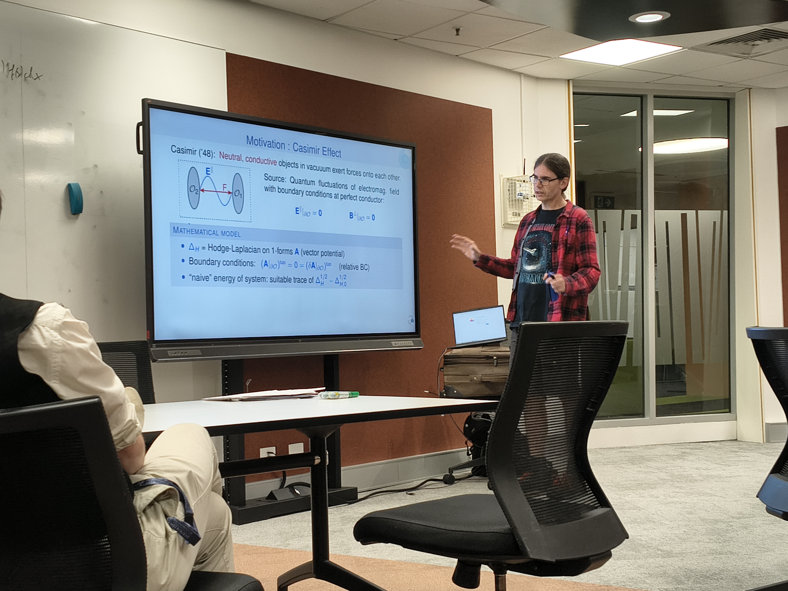
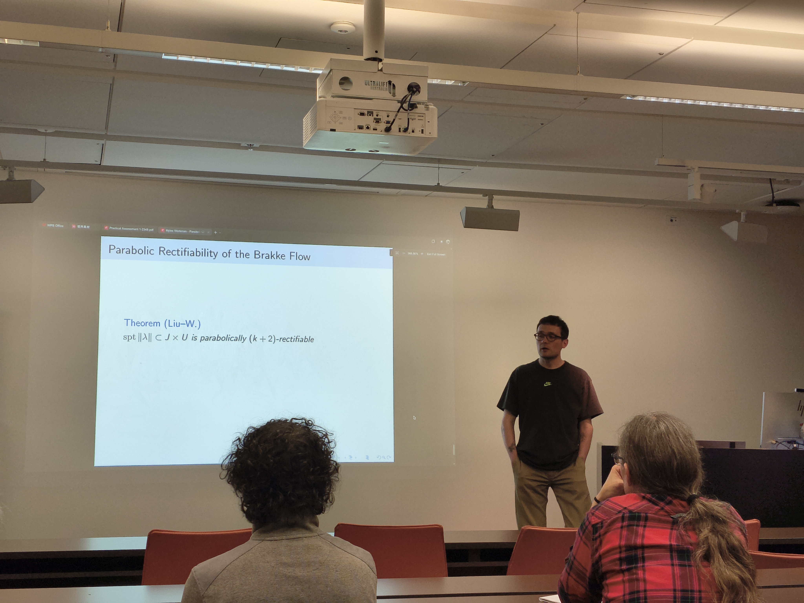
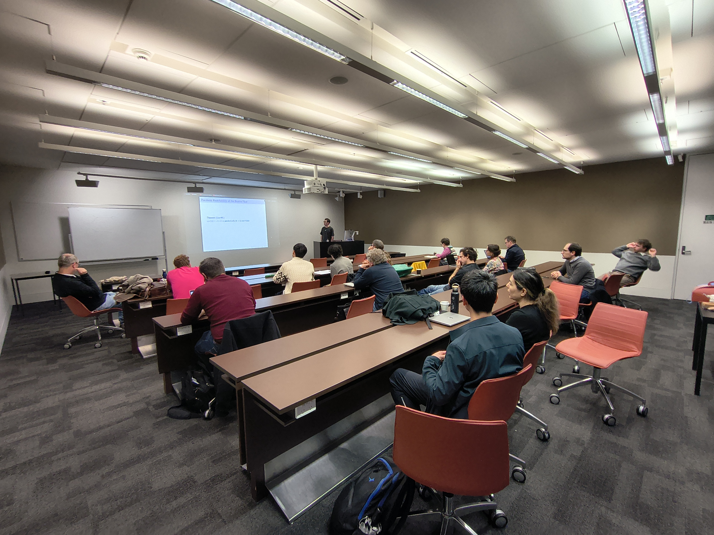
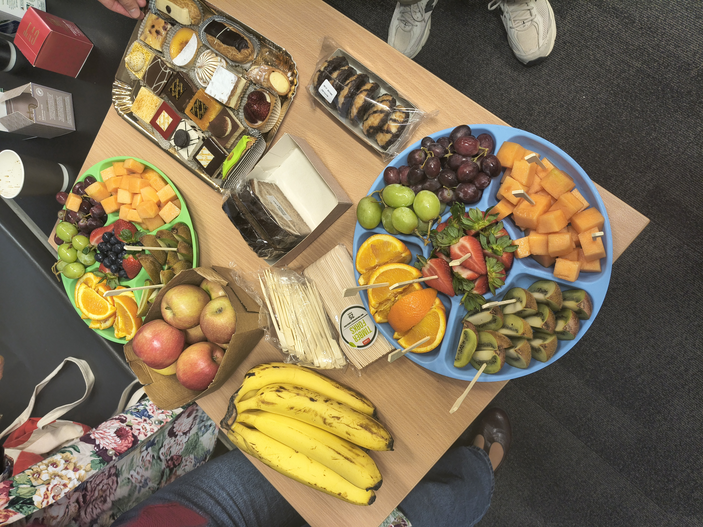
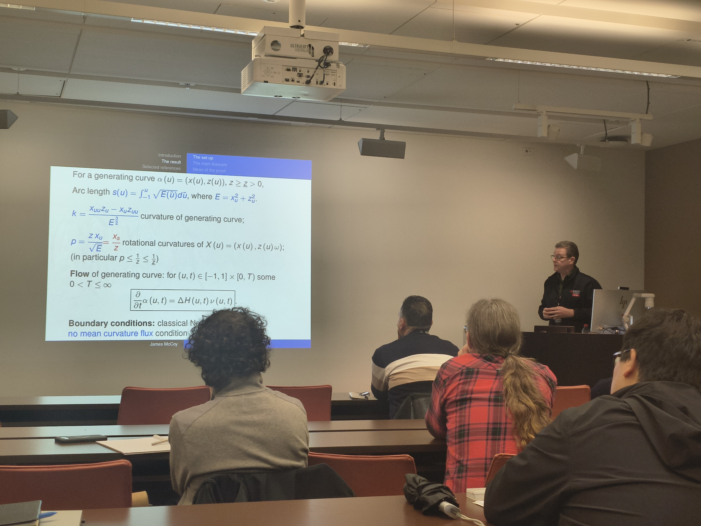
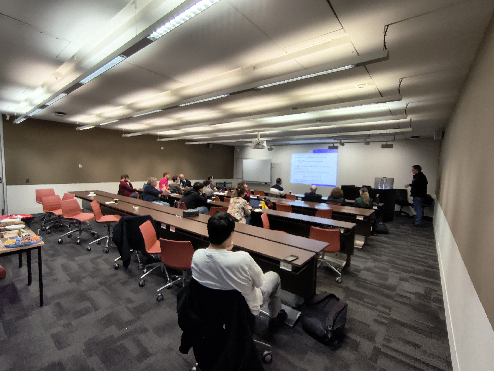

The third  seminar of the Victorian GAP took place on the 28nd August 2026.

<!--more-->

The speakers were [Florian Hanisch](https://www.math.uni-potsdam.de/en/professuren/geometry/team/dr-florian-hanisch) (Potsdam University), [James McCoy](https://www.rmit.edu.au/profiles/m/james-mccoy)  (Royal Melbourne Institute of Technology), and [Myles Workman](https://sites.google.com/view/myles-workman-math/home) (National Taiwan Normal University)

It was was attended by 24 participants and  held at the [Royal Melblurne Institute of Technology](https://www.rmit.edu.au/). The event was also supported by RMIT with tea and coffee.

Those in Victoria working on topics related to geometry, analysis and PDE and would like to become members and to be included in: https://vicgap.org/members/, please [email](mailto:geometry.analysis.pde@gmail.com) us with the following: 

  -  editing out the [MYNAME.md](/uploads/MYNAME.md) file attached in the fields
  - a headshot image of about 400x400 pixels (optional, although highly recommended!).

Here are some images from the day.

       
